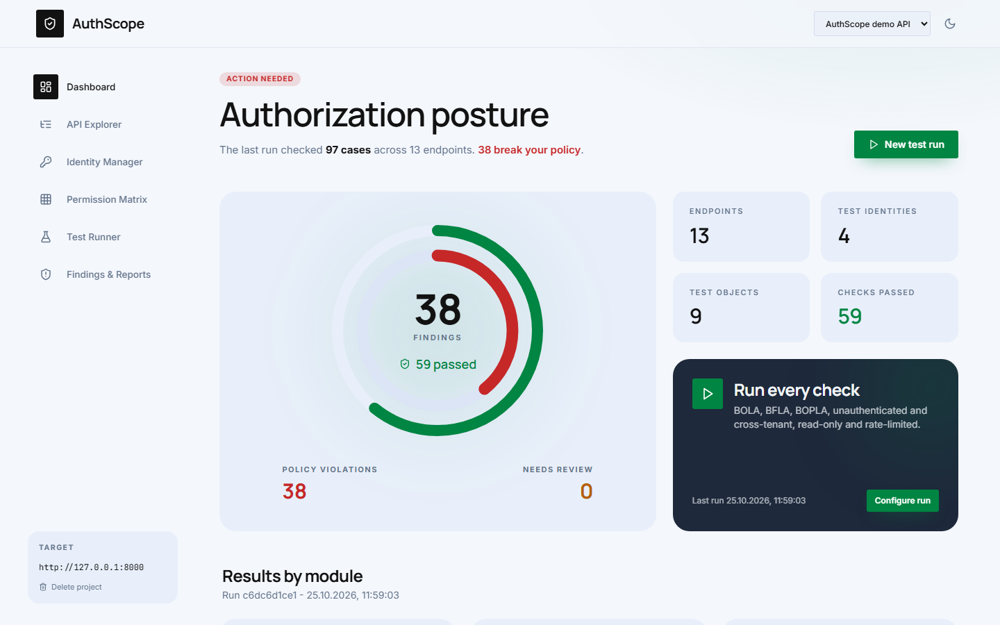
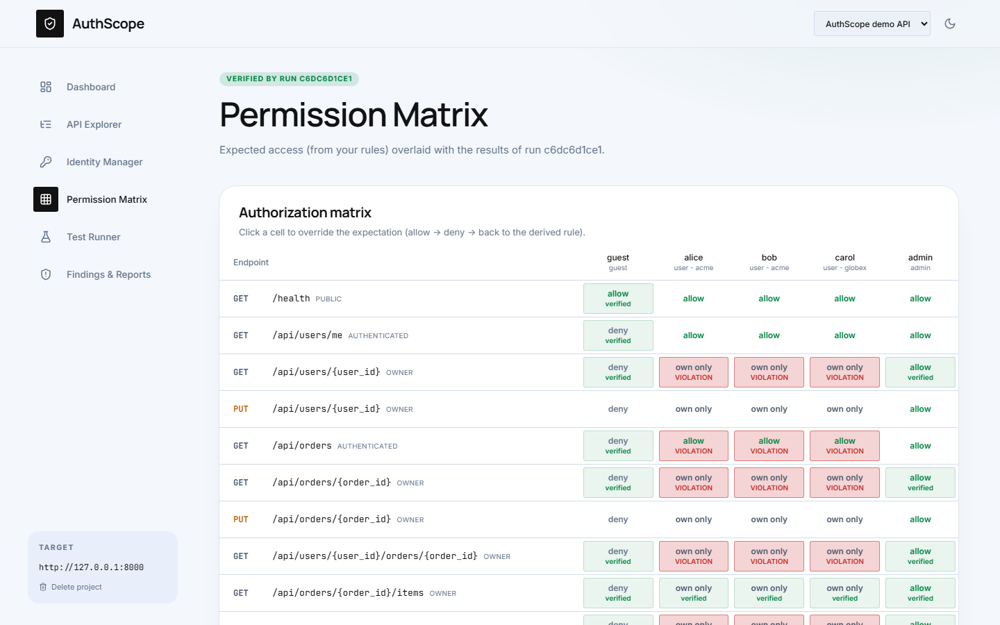

# AuthScope: API Authorization Testing Platform

[](https://github.com/TroubieD3v/AuthScope/actions/workflows/ci.yml)
[](LICENSE)


**English** · [Русский](README.ru.md)

AuthScope is an open-source tool for finding **authorization bugs in REST APIs**: BOLA/IDOR, BFLA, Broken Object
Property Level Authorization, missing authentication and cross-tenant leaks. You connect your API, import
OpenAPI or a Postman collection, add a few test accounts and say who owns which objects. AuthScope then checks
who can **actually** reach which data and functions, and compares that with the access policy you expect.

It does not stop at "the API returned 200". It reports *"Bob got access to Alice's order 101, contrary to the
configured policy"* with both requests, the response differences, the expected rule and a command to reproduce it.

> **Warning**: test only APIs you own or are authorized to test. The engine contacts nothing but the hosts you list,
> is read-only by default and rate-limited. The bundled `demo_api` is vulnerable on purpose; never expose it.
> See [SECURITY.md](SECURITY.md) and the [threat model](docs/threat-model.md).


*A run against the demo API: the matrix shows where real behaviour breaks the expected policy, and every finding
opens with both requests side by side.*


| Evidence for a finding | Dashboard |
|---|---|
|  |  |

Dark is the default theme; the switch in the top bar changes to light (remembered per browser).

| Light theme: dashboard | Light theme: permission matrix |
|---|---|
|  |  |

## Checks

Five modules covering the authorization categories of the
[OWASP API Security Top 10:2023](https://owasp.org/API-Security/editions/2023/en/0x11-t10/).

| Module | Finds | OWASP API Top 10:2023 |
|---|---|---|
| BOLA / IDOR | User B reads User A's object; list endpoints that return other users' objects | API1 Broken Object Level Authorization |
| BFLA | Regular users calling admin functions | API5 Broken Function Level Authorization |
| BOPLA | Responses exposing properties a role must not see, e.g. `internalNotes` | API3 Broken Object Property Level Authorization |
| Unauthenticated Access | Protected endpoints answering without a token or with an invalid one | API2 Broken Authentication |
| Cross-Tenant Access | Tenant A reaching objects and lists of tenant B | API1 Broken Object Level Authorization |
| Custom tests | Your explicit allow/deny cases from the YAML config | - |

Every module records what **passed** as well as what failed, and explains inconclusive or skipped cases.

### How a verdict is reached

```
Baseline  alice -> GET /api/orders/101   200, her own order
Test      bob   -> GET /api/orders/101   ?
```

| Observed for the other identity | Verdict |
|---|---|
| 401 / 403 / 404, redirect to a login page | pass |
| 200 with an empty body, `[]` or `{}` | pass: filtering, **not** BOLA |
| 200 with an error envelope (`{"error": ...}`) | pass: soft denial |
| 200 containing the requested object's id, backed by the owner's other fields | **violation** |
| 200 with similar data but no matching id, or an id with unrelated data | needs review |
| 200 with data that does not match the object | needs review |
| 400 / 422 / 5xx / unfollowed redirect, or the owner's own baseline failed | inconclusive |

## Workflow

1. **Target**: base URL and an explicit list of allowed hosts.
2. **Endpoints**: import OpenAPI 3 / Swagger 2 (JSON, YAML) or a Postman collection (v2.0, v2.1), or add them by
   hand. Specs describe *how* to authenticate, not *who owns what*, so access rules are proposed and marked
   "inferred" until you confirm them.
3. **Identities**: guest, users, admins, optionally with a tenant. Credentials as Bearer token, custom header,
   cookie, API key in the query string, HTTP Basic, or a login flow that fetches the token at the start of each run.
4. **Objects**: which test objects belong to whom (`order 101 -> alice`), including parents for nested paths like
   `/users/{user_id}/orders/{order_id}`.
5. **Policy**: per endpoint `public`, `authenticated`, `owner`, `tenant` or `roles`, restricted response fields,
   and per-cell overrides in the Permission Matrix.
6. **Run** and read the matrix, the findings and the reports (HTML, Markdown, JSON, pytest).

The interface has six screens: Dashboard, API Explorer, Identity Manager, Permission Matrix, Test Runner, and
Findings & Reports, in a dark (default) and a light theme. Palette: primary `#121212`, secondary `#008542`,
tertiary `#D97706`, neutral `#64748B`; headlines in Manrope, body in Inter (fonts are bundled, no CDN).

| API Explorer | Identity Manager |
|---|---|
|  |  |

## Quick start (Docker)

Requires Docker with Compose v2.

```bash
git clone https://github.com/TroubieD3v/AuthScope.git
cd AuthScope
docker compose up --build
```

Open <http://localhost:8080>, click **Load demo project**, then **Test Runner -> Start run**. Ports `8080`
(AuthScope) and `8000` (demo API) are bound to the loopback interface only. Data is kept in the `authscope-data`
volume; `docker compose down --volumes` deletes it.

**Troubleshooting**

- *Port 8080 or 8000 already in use*: `AUTHSCOPE_PORT=8090 DEMO_PORT=8001 docker compose up --build`
  (PowerShell: `$env:AUTHSCOPE_PORT=8090; docker compose up --build`).
- *Open it as `localhost` or `127.0.0.1`*: other host names are rejected (DNS-rebinding protection).
- *Identities show "no token" after a restart*: tokens typed in the UI live in memory only. Enter them again or
  pass `AUTHSCOPE_TOKEN_<NAME>` environment variables.

## Local development (no Docker)

```bash
python -m venv .venv && . .venv/bin/activate          # Windows: .venv\Scripts\activate
pip install -e ".[dev]"
cd frontend && npm install && npm run build && cd ..

python -m demo_api                    # 1. demo API on :8000 (separate terminal)
authscope serve                       # 2. UI + API on :8080
cd frontend && npm run dev            # optional: UI with hot reload on :5173
```

## Command line and CI

```bash
set -a; . examples/demo.env; set +a
authscope run -c examples/demo.authscope.yaml -f md -o report.md        # exit code 1 if violations
authscope run -c examples/demo.authscope.yaml -f pytest -o test_authz.py  # regression tests from findings
authscope run -c my.yaml -m bola -m bfla --allow-mutating               # chosen modules, writes enabled
```

Tokens never go into the config: use `AUTHSCOPE_TOKEN_<NAME>` / `AUTHSCOPE_PASSWORD_<NAME>`. A minimal config:

```yaml
target:
  base_url: http://127.0.0.1:8000
  allowed_hosts: [127.0.0.1]
identities: [alice, bob, admin]
resources:
  - { type: order, id: 101, owner: alice }
endpoints:
  - { method: GET, path: "/api/orders/{order_id}", access: owner, allow_roles: [admin], resource_type: order }
tests:
  - { name: Cross-user order access, path: /api/orders/101, identity: bob, expected: deny, baseline_identity: alice }
```

Objects without a single id field can be identified by JSONPath rules (composite identifiers); a response then
"contains the object" only when every rule matches, and look-alikes stay in *needs review*:

```yaml
resources:
  - type: order
    id: acme/101
    owner: alice
    match: { "$.tenant": acme, "$.number": "101" }   # supported: .key ['key'] [0] [*] ..key
```

Full example: [examples/demo.authscope.yaml](examples/demo.authscope.yaml). Add `openapi: ./spec.yaml` or
`postman: ./collection.json` to merge endpoints from a file. The `authz-gate` job in
[ci.yml](.github/workflows/ci.yml) shows AuthScope as an authorization regression gate.

## Safety

- Explicit host allow-list, no wildcards; host, port, scheme, credentials-in-URL and path checked per request.
- Each host is resolved once per request, the address is validated, and the connection goes to exactly that address
  (DNS pinning; Host header and TLS name kept). Link-local and cloud-metadata ranges are always blocked; redirects
  are not followed by default.
- 5 requests/s and a 500-request budget per run by default. `429 Too Many Requests` is retried after `Retry-After`
  (capped, within the budget); timeouts and connection errors are retried only for read-only requests, never for
  writes. After 8 consecutive unreachable responses the run stops and says the target is unavailable.
- Read-only by default. State-changing tests need an explicit switch and a reset endpoint that runs after every write.
- Secrets are never stored in the config, the database or reports; evidence is masked.
- The service binds to `127.0.0.1` and rejects foreign `Host` headers.

## Tests

```bash
pytest                                  # engine, modules, imports, API, CLI, corpus and property tests
playwright install chromium
pytest -m e2e                           # browser test of the full UI workflow
python scripts/screenshots.py           # regenerate the screenshots in this README
```

The demo API plants one flaw per module and can be switched to a fully secure mode (`DEMO_VULNS=`). The suite
proves that every planted flaw is found **and** that the secure variant produces zero findings.

- `tests/corpus/cases.yaml`: 40+ annotated tricky responses (look-alike objects, ids in wrappers, pagination
  wrappers, GraphQL errors, HTML login pages with 200, truncated JSON...) with the verdict each must get.
- Property-based tests (Hypothesis): a 200 without the requested id is never a confirmed violation, the
  classifier never crashes, and a known secret never survives masking wherever it is placed.
- A second, independently written test stand (`python -m ledger_api`) uses other conventions: API keys,
  UUIDs, `{"data": ...}` envelopes, refusals as HTTP 200 with an `errors` array, composite invoice ids.
- `scripts/ci_gate.py` runs in CI against a correct and a flawed instance of **both** stands: zero findings on one, exactly the
  expected list ([examples/expected-findings.json](examples/expected-findings.json)) on the other, evidence that
  points at the reported object, and no credentials in any report format.

Results: **52 of 52 planted flaws found, 0 false positives** on the correct instances - see
[docs/benchmarks.md](docs/benchmarks.md) for the table, the limits of these numbers and how to reproduce them.

CI also builds the Docker image and runs the browser test.

## Architecture

```
Browser ──► AuthScope (FastAPI :8080, serves the React UI) ──► Requester (guard, rate limit) ──► your API
                    └──► SQLite: projects, runs, masked results
```

- `backend/authscope/`: config and policy, safety guard, HTTP engine, comparison, modules, runner, importers,
  reports, storage, web API, CLI.
- `backend/demo_api/`, `backend/ledger_api/`: the two intentionally flawed test stands.
- `frontend/`: React + TypeScript + Vite + Tailwind CSS, shadcn-style components, design tokens in `src/index.css`.
- `tests/`: unit, integration, CLI and Playwright tests. `docs/`: architecture and threat model.

Details: [docs/architecture.md](docs/architecture.md) · [docs/threat-model.md](docs/threat-model.md) ·
[docs/benchmarks.md](docs/benchmarks.md) ·
[CONTRIBUTING.md](CONTRIBUTING.md) · [CHANGELOG.md](CHANGELOG.md).

## Roadmap

Mass Assignment and Session Authorization modules, and a Burp Suite extension, are tracked as
[issues](https://github.com/TroubieD3v/AuthScope/issues).

## Releases

| Version | Result |
|---|---|
| v1.0.0 | Five modules, baseline comparison, evidence and reports, OpenAPI and Postman import, login flow, web UI, CLI, Docker |
| v1.1.0 | API key and HTTP Basic auth, nested object paths, screenshots, docs, issue and PR templates |
| v1.2.0 | Stricter comparison (object id required for a violation), DNS pinning, repository renamed to AuthScope |
| v1.3.0 | Redesigned interface: dark theme by default with a light theme switch, new palette and typography, redesigned HTML report |
| v1.4.0 | Two-sided CI gate, false-positive corpus and property tests, 429/retry handling, composite identifiers via JSONPath |
| **v1.5.0** | **Independent ledger test stand, gate on both stands, per-object path parameters, benchmark results** |

## License

[MIT](LICENSE)
