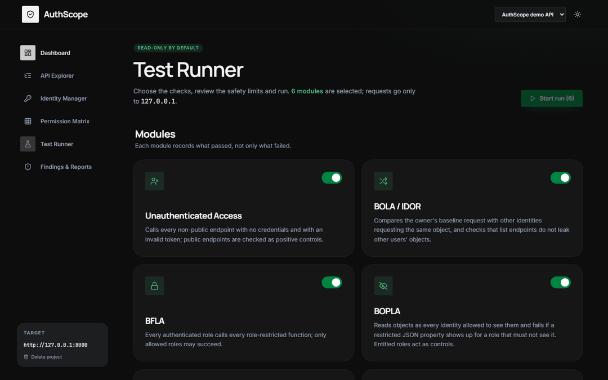
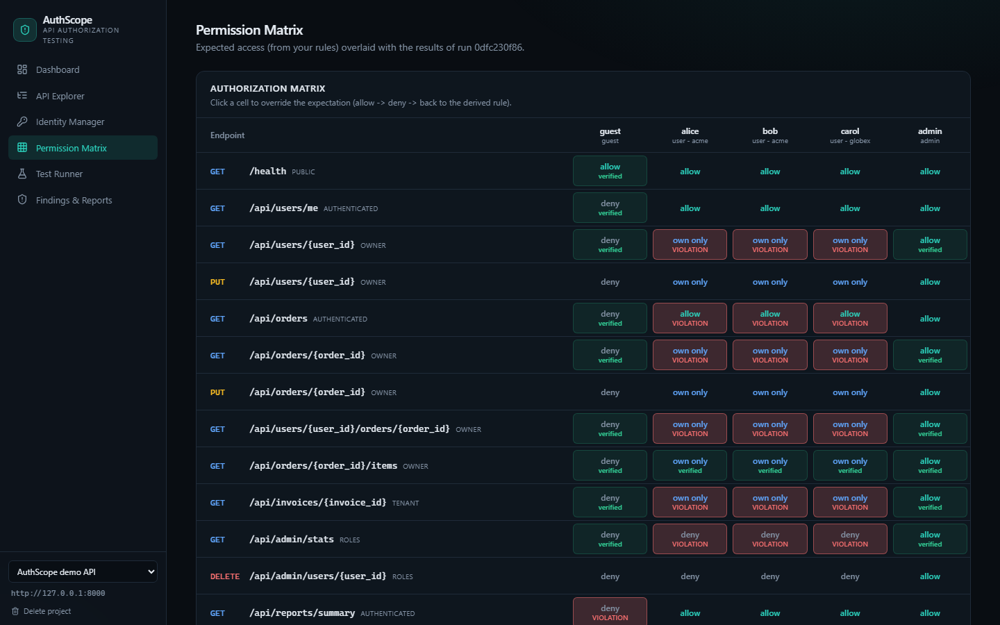
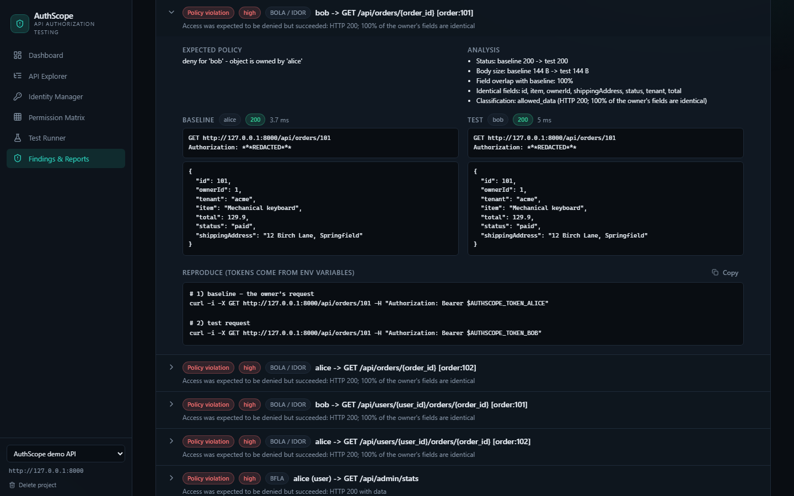
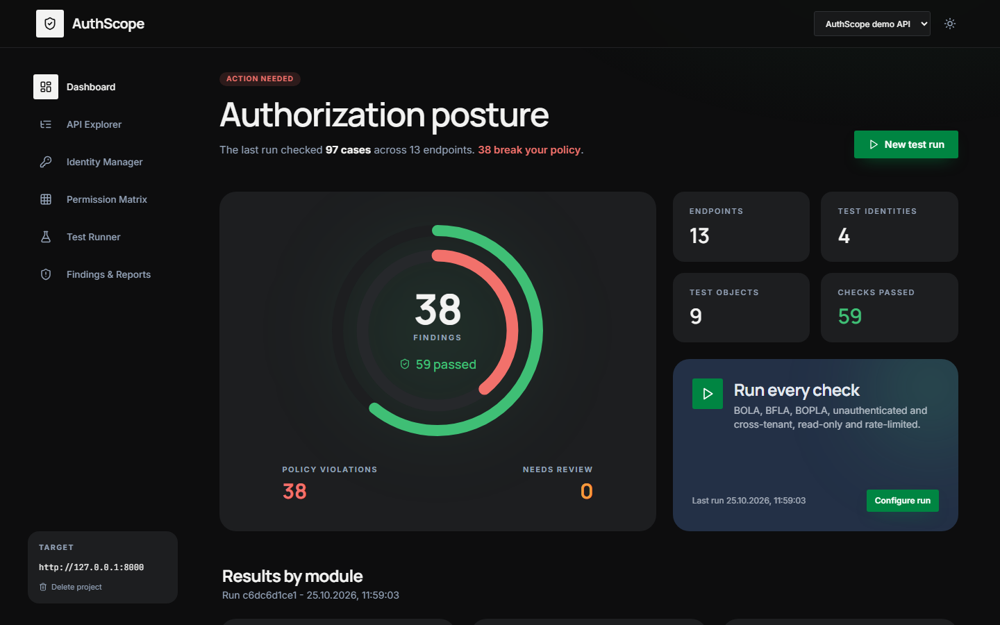
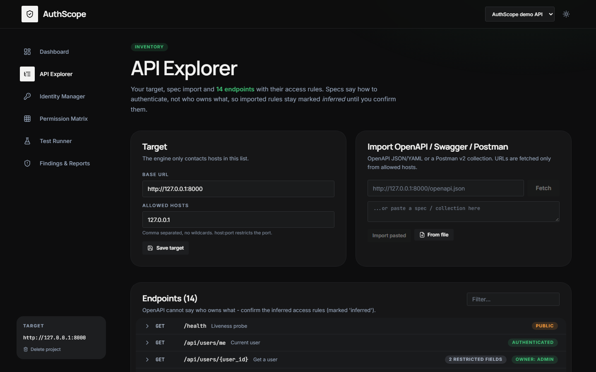
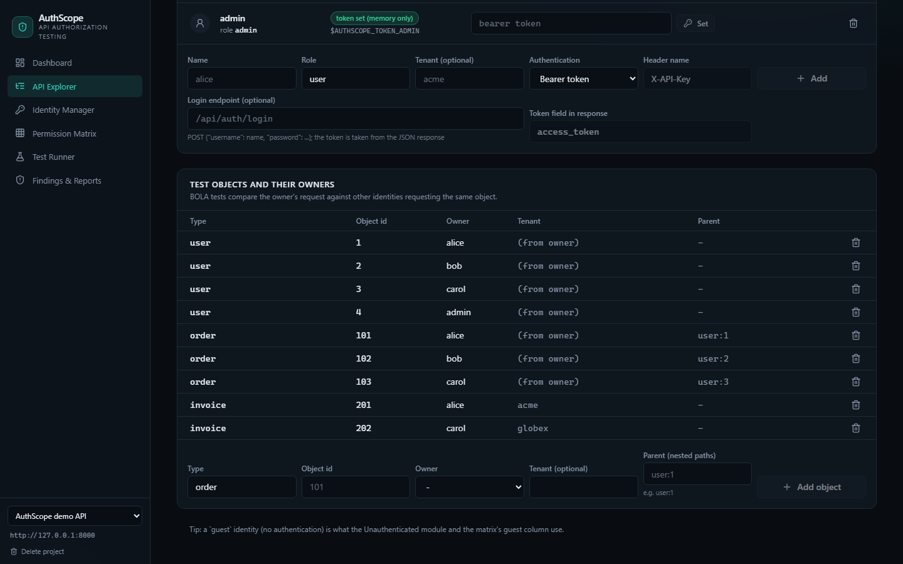

# AuthScope: платформа для тестирования авторизации API

[](https://github.com/TroubieD3v/AuthScope/actions/workflows/ci.yml)
[](LICENSE)


[English](README.md) · **Русский**

AuthScope — open-source инструмент для поиска **ошибок авторизации в REST API**: BOLA/IDOR, BFLA, Broken Object
Property Level Authorization, отсутствующей аутентификации и утечек между организациями (tenant). Вы подключаете
своё API, импортируете OpenAPI или коллекцию Postman, добавляете несколько тестовых аккаунтов и указываете, кому
какие объекты принадлежат. AuthScope проверяет, кто **на самом деле** получает доступ к каким данным и функциям, и
сравнивает это с ожидаемой политикой доступа.

Он не останавливается на «API вернул 200». Отчёт звучит так: *«Bob получил доступ к заказу 101, который принадлежит
Alice, вопреки настроенной политике»* — с обоими запросами, различиями ответов, ожидаемым правилом и командой для
воспроизведения.

> **Внимание**: тестируйте только API, которыми владеете или на проверку которых есть разрешение. Движок обращается
> только к перечисленным хостам, по умолчанию работает в режиме «только чтение» и с ограничением скорости.
> Демо-API `demo_api` уязвимо намеренно, не открывайте его в сеть. См. [SECURITY.md](SECURITY.md) и
> [модель угроз](docs/threat-model.md).



*Запуск на демо-API: матрица показывает, где реальное поведение нарушает ожидаемую политику, а каждая находка
открывается с двумя запросами рядом.*



| Доказательства находки | Dashboard |
|---|---|
|  |  |

## Проверки

Пять модулей покрывают категории авторизации из
[OWASP API Security Top 10:2023](https://owasp.org/API-Security/editions/2023/en/0x11-t10/).

| Модуль | Что находит | OWASP API Top 10:2023 |
|---|---|---|
| BOLA / IDOR | Пользователь B читает объект пользователя A; списки, возвращающие чужие объекты | API1 Broken Object Level Authorization |
| BFLA | Обычный пользователь вызывает административные функции | API5 Broken Function Level Authorization |
| BOPLA | В ответе есть поля, которые роль видеть не должна, например `internalNotes` | API3 Broken Object Property Level Authorization |
| Unauthenticated Access | Защищённые эндпоинты отвечают без токена или с неверным токеном | API2 Broken Authentication |
| Cross-Tenant Access | Организация A получает объекты и списки организации B | API1 Broken Object Level Authorization |
| Custom tests | Ваши явные случаи allow/deny из YAML-конфига | - |

Каждый модуль показывает не только провалы, но и **успешные** проверки, а для пропущенных и неопределённых
объясняет причину.

### Как выносится вердикт

```
Baseline  alice -> GET /api/orders/101   200, её собственный заказ
Test      bob   -> GET /api/orders/101   ?
```

| Что получил другой аккаунт | Вердикт |
|---|---|
| 401 / 403 / 404, редирект на страницу входа | pass |
| 200 с пустым телом, `[]` или `{}` | pass: фильтрация, **не** BOLA |
| 200 с ошибкой в теле (`{"error": ...}`) | pass: мягкий отказ |
| 200 с id запрошенного объекта, подтверждённым другими полями владельца | **нарушение** |
| 200 с похожими данными, но без совпадения id, или id с посторонними данными | нужна ручная проверка |
| 200 с данными, которые не соответствуют объекту | нужна ручная проверка |
| 400 / 422 / 5xx / редирект без перехода, или не прошёл baseline владельца | неопределённо |

## Как пользоваться

1. **Цель**: базовый адрес и явный список разрешённых хостов.
2. **Эндпоинты**: импорт OpenAPI 3 / Swagger 2 (JSON, YAML) или коллекции Postman (v2.0, v2.1), либо ручное
   добавление. Спецификация описывает, *как* аутентифицироваться, но не *кому что принадлежит*, поэтому правила
   доступа предлагаются с пометкой «inferred», пока вы их не подтвердите.
3. **Аккаунты**: guest, пользователи, администраторы, при необходимости с организацией. Учётные данные: Bearer-токен,
   свой заголовок, cookie, API-ключ в query, HTTP Basic или вход через login-эндпоинт в начале каждого запуска.
4. **Объекты**: какие тестовые объекты кому принадлежат (`order 101 -> alice`), включая родителей для вложенных путей
   вида `/users/{user_id}/orders/{order_id}`.
5. **Политика**: для каждого эндпоинта `public`, `authenticated`, `owner`, `tenant` или `roles`, запрещённые поля
   ответа и ручные переопределения ячеек в матрице.
6. **Запуск**: матрица, находки и отчёты (HTML, Markdown, JSON, pytest).

В интерфейсе шесть экранов: Dashboard, API Explorer, Identity Manager, Permission Matrix, Test Runner и
Findings & Reports.

| API Explorer | Identity Manager |
|---|---|
|  |  |

## Быстрый старт (Docker)

Нужен Docker с Compose v2.

```bash
git clone https://github.com/TroubieD3v/AuthScope.git
cd AuthScope
docker compose up --build
```

Откройте <http://localhost:8080>, нажмите **Load demo project**, затем **Test Runner -> Start run**. Порты `8080`
(AuthScope) и `8000` (демо-API) открыты только на loopback-интерфейсе. Данные хранятся в томе `authscope-data`;
`docker compose down --volumes` удаляет их.

**Если что-то не работает**

- *Порт 8080 или 8000 занят*: `AUTHSCOPE_PORT=8090 DEMO_PORT=8001 docker compose up --build`
  (PowerShell: `$env:AUTHSCOPE_PORT=8090; docker compose up --build`).
- *Открывайте через `localhost` или `127.0.0.1`*: другие имена хоста отклоняются (защита от DNS rebinding).
- *После перезапуска у аккаунтов «no token»*: токены из интерфейса хранятся только в памяти. Введите их снова или
  передайте переменные окружения `AUTHSCOPE_TOKEN_<NAME>`.

## Локальная разработка (без Docker)

```bash
python -m venv .venv && . .venv/bin/activate          # Windows: .venv\Scripts\activate
pip install -e ".[dev]"
cd frontend && npm install && npm run build && cd ..

python -m demo_api                    # 1. демо-API на :8000 (в отдельном терминале)
authscope serve                       # 2. интерфейс и API на :8080
cd frontend && npm run dev            # по желанию: интерфейс с hot reload на :5173
```

## Командная строка и CI

```bash
set -a; . examples/demo.env; set +a
authscope run -c examples/demo.authscope.yaml -f md -o report.md        # код выхода 1, если есть нарушения
authscope run -c examples/demo.authscope.yaml -f pytest -o test_authz.py  # регрессионные тесты из находок
authscope run -c my.yaml -m bola -m bfla --allow-mutating               # выбранные модули, с изменяющими запросами
```

Токены в конфиг не попадают: используйте `AUTHSCOPE_TOKEN_<NAME>` / `AUTHSCOPE_PASSWORD_<NAME>`. Минимальный конфиг:

```yaml
target:
  base_url: http://127.0.0.1:8000
  allowed_hosts: [127.0.0.1]
identities: [alice, bob, admin]
resources:
  - { type: order, id: 101, owner: alice }
endpoints:
  - { method: GET, path: "/api/orders/{order_id}", access: owner, allow_roles: [admin], resource_type: order }
tests:
  - { name: Cross-user order access, path: /api/orders/101, identity: bob, expected: deny, baseline_identity: alice }
```

Полный пример: [examples/demo.authscope.yaml](examples/demo.authscope.yaml). Добавьте `openapi: ./spec.yaml` или
`postman: ./collection.json`, чтобы подтянуть эндпоинты из файла. Задание `authz-gate` в
[ci.yml](.github/workflows/ci.yml) показывает, как использовать AuthScope для проверки авторизации в CI.

## Безопасность

- Явный список разрешённых хостов, без wildcard; хост, порт, схема, логин/пароль в URL и путь проверяются для
  каждого запроса.
- Хост резолвится один раз на запрос, адрес проверяется, и соединение идёт ровно на этот адрес (DNS pinning;
  заголовок Host и имя для TLS сохраняются). Link-local и адреса облачных метаданных всегда заблокированы; редиректы
  по умолчанию не выполняются.
- По умолчанию 5 запросов в секунду и не более 500 запросов за запуск.
- По умолчанию только чтение. Изменяющие проверки включаются явно и требуют эндпоинта сброса, который вызывается
  после каждой записи.
- Секреты не сохраняются в конфиг, базу и отчёты; доказательства маскируются.
- Сервис слушает только `127.0.0.1` и отклоняет чужие заголовки `Host`.

## Тесты

```bash
pytest                                  # 53 теста: движок, модули, импорт, API, CLI на демо-API
playwright install chromium
pytest -m e2e                           # браузерный тест всего сценария в интерфейсе
python scripts/screenshots.py           # перегенерировать скриншоты для README
```

Демо-API содержит по одной уязвимости на модуль и переключается в полностью безопасный режим (`DEMO_VULNS=`).
Тесты доказывают, что каждая заложенная уязвимость находится **и** что безопасный вариант даёт ноль находок. CI
также собирает Docker-образ и запускает браузерный тест.

## Архитектура

```
Браузер ──► AuthScope (FastAPI :8080, отдаёт React UI) ──► Requester (защита, лимиты) ──► ваше API
                    └──► SQLite: проекты, запуски, замаскированные результаты
```

- `backend/authscope/`: конфиг и политика, защитные ограничения, HTTP-движок, сравнение ответов, модули, раннер,
  импорт, отчёты, хранилище, веб-API, CLI.
- `backend/demo_api/`: намеренно уязвимое демо-API.
- `frontend/`: React + TypeScript + Vite + Tailwind CSS, компоненты в стиле shadcn.
- `tests/`: unit, интеграционные, CLI и Playwright-тесты. `docs/`: архитектура и модель угроз.

Подробнее: [docs/architecture.md](docs/architecture.md) · [docs/threat-model.md](docs/threat-model.md) ·
[CONTRIBUTING.md](CONTRIBUTING.md) · [CHANGELOG.md](CHANGELOG.md).

## Планы

Модули Mass Assignment и Session Authorization, а также расширение для Burp Suite ведутся в
[issues](https://github.com/TroubieD3v/AuthScope/issues).

## Релизы

| Версия | Что вошло |
|---|---|
| v1.0.0 | Пять модулей, сравнение с baseline, доказательства и отчёты, импорт OpenAPI и Postman, вход через login-эндпоинт, веб-интерфейс, CLI, Docker |
| v1.1.0 | API-ключ в query и HTTP Basic, вложенные пути объектов, скриншоты, документация, шаблоны issue и PR |
| **v1.2.0** | **Строже сравнение (для нарушения нужен id объекта), DNS pinning, репозиторий переименован в AuthScope** |

## Лицензия

[MIT](LICENSE)
